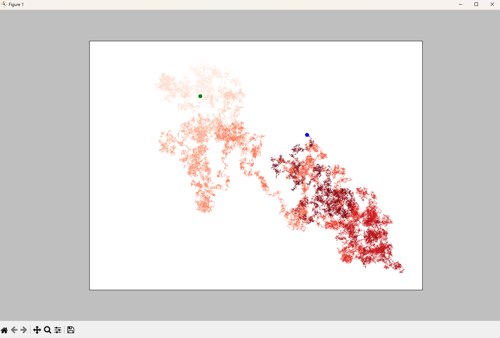

# Data Visualization

Small Matplotlib examples from _Python Crash Course_, covering line charts,
scatter plots, and random walks.

## Examples

| Script                                                                   | Description                                                                                                                  |
| ------------------------------------------------------------------------ | ---------------------------------------------------------------------------------------------------------------------------- |
| [`mpl_squares.py`](mpl_squares.py)                                       | Plots square numbers as a line chart. Includes a commented-out scatter-plot variant.                                         |
| [`mpl_cubes.py`](mpl_cubes.py)                                           | Plots cube numbers as a scatter plot, with point colors mapped to their values.                                              |
| [`random_walk/random_walk.py`](random_walk/random_walk.py)               | Defines the `RandomWalk` class, which generates a walk as a sequence of x- and y-coordinates.                                |
| [`random_walk/random_walk_visual.py`](random_walk/random_walk_visual.py) | Displays a 50,000-point random walk with highlighted start and end points. Prompts to generate another walk after each plot. |

## Previews

### Cube numbers: scatter plot


### Random walk



## Usage

Run the first two scripts from this directory:

```bash
python mpl_squares.py
python mpl_cubes.py
```

Run the random-walk visualization from its own directory so Python can import
`random_walk.py`:

```bash
cd random_walk
python random_walk_visual.py
```

After each plot, the script asks whether to generate another walk.
