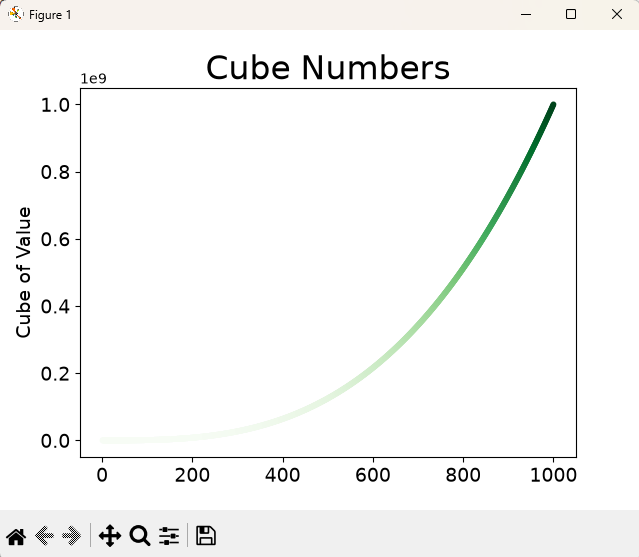

# Data Visualization

Small visualization examples from _Python Crash Course_, built with
[Matplotlib](https://matplotlib.org/) and [Plotly](https://plotly.com/python/).

## Examples

| Example                                | Description                                                                          |
| -------------------------------------- | ------------------------------------------------------------------------------------ |
| [`mpl_squares.py`](mpl_squares.py)     | Plots square numbers as a line chart. Includes a commented-out scatter-plot variant. |
| [`mpl_cubes.py`](mpl_cubes.py)         | Plots cube numbers as a scatter plot, with point colors mapped to their values.      |
| [Random walk](random_walk/README.md)   | Generates and plots a random walk with highlighted start and end points.             |
| [Rolling dice](rolling_dice/README.md) | Simulates dice rolls and plots how often each result occurs.                         |

## Preview

### Cube numbers



_Cubes of the numbers 1 to 5000, colored by value._

## Usage

Run the Matplotlib examples from this directory:

```bash
python mpl_squares.py
python mpl_cubes.py
```
