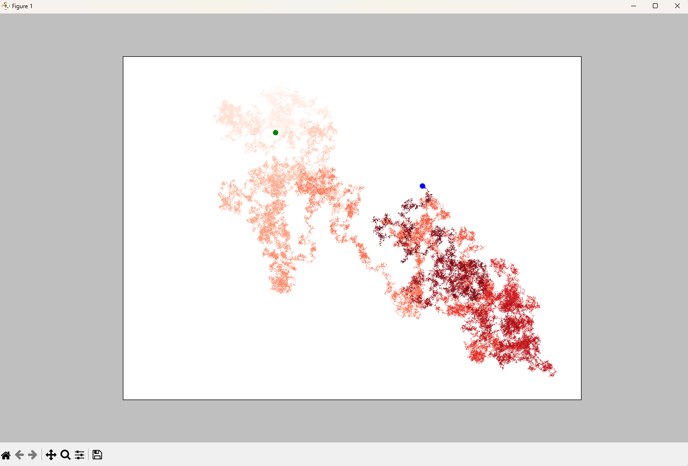

# Random Walk

Generate and plot a random walk, a path where each step goes in a random
direction by a random distance. Built with [Matplotlib](https://matplotlib.org/).

## Examples

| Script                                           | Description                                                                                                          |
| ------------------------------------------------ | -------------------------------------------------------------------------------------------------------------------- |
| [`random_walk.py`](random_walk.py)               | Defines the `RandomWalk` class, which generates a walk as a sequence of x- and y-coordinates.                        |
| [`random_walk_visual.py`](random_walk_visual.py) | Plots a 50,000-point random walk with highlighted start and end points. Prompts to generate another after each plot. |

## Usage

Run the visualization from this directory so it can import `random_walk.py`:

```bash
python random_walk_visual.py
```

After each plot, the script asks whether to generate another walk. Enter `y` to
continue or `n` to quit.

## Preview



_A 50,000-point random walk. The start point is marked in green and the end point in blue._
