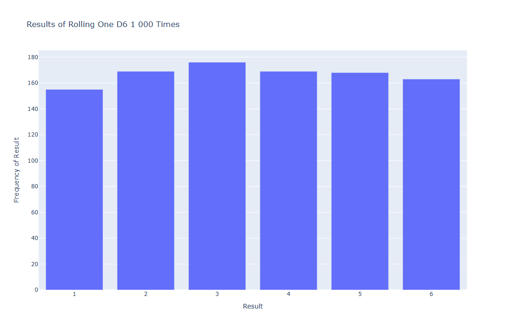
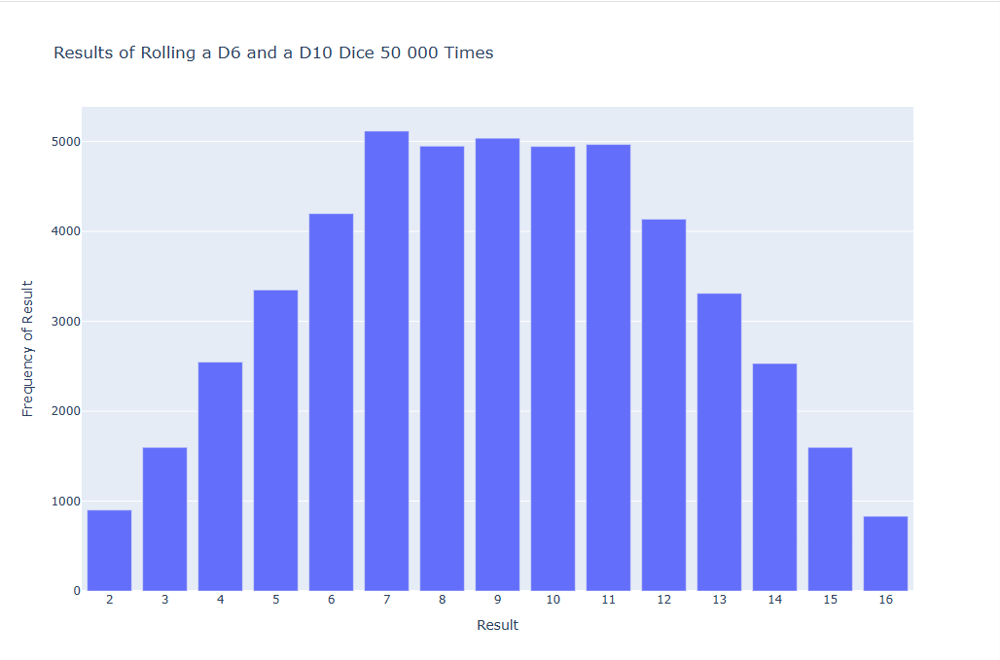

# Rolling Dice

Simulate dice rolls and visualize how often each result occurs, using
[Plotly Express](https://plotly.com/python/plotly-express/).

## Examples

| Script                             | Description                                                                                 |
| ---------------------------------- | ------------------------------------------------------------------------------------------- |
| [`die.py`](die.py)                 | Defines the `Die` class used by both visualizations.                                        |
| [`die_visual.py`](die_visual.py)   | Rolls one six-sided die 1,000 times and plots the frequency of each face.                   |
| [`dice_visual.py`](dice_visual.py) | Rolls a six-sided die and a ten-sided die 50,000 times, sums each pair, and plots the sums. |

## Screenshots

### Single die (`die_visual.py`)

_1,000 rolls of one D6. Results should be roughly even across all six faces._

### Two dice (`dice_visual.py`)

_50,000 rolls of a D6 plus a D10. Middle sums occur most often._
