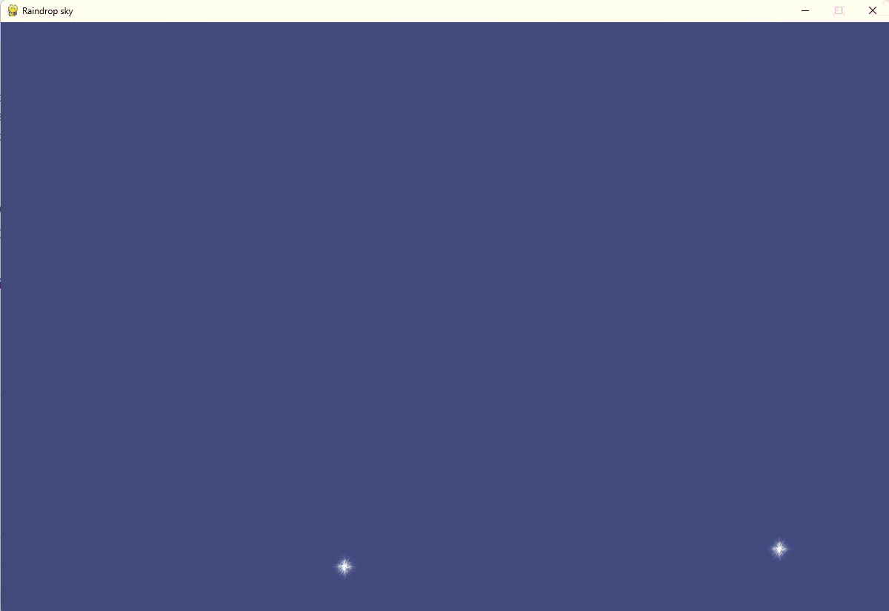

# Raindrop Sky

A small Pygame animation in which rows of raindrops fall down the screen.

## Behavior

Rain has two spawning modes:

- **Row-by-row (default):** When a row of raindrops falls off the bottom of
  the screen, a new row appears at the top and starts to fall.
- **Continuous:** New rows are added at regular intervals while earlier rows
  are still falling, so the screen fills with rain.

## Controls

| Input            | Action                                                                                           |
| ---------------- | ------------------------------------------------------------------------------------------------ |
| **S**            | Toggle continuous spawning on or off. Drops already on screen keep falling when you turn it off. |
| **Close window** | Exit the game.                                                                                   |
